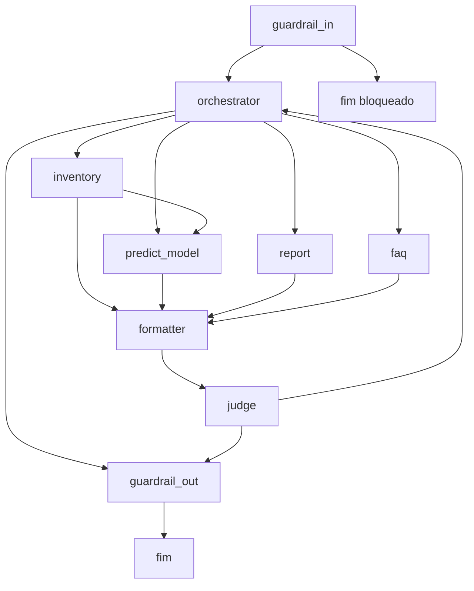

# ms-artificial-intelligence-core

[](https://www.python.org/downloads/release/python-3110/)
[](LICENSE)

Assistente do sistema Zera: um turno de conversa entra num grafo LangGraph (guardrails, orquestração, FAQ, relatório de descarte, previsão de falha e consulta ao inventário) e sai como resposta em texto ou PDF. Parte de um sistema maior composto também pelo
[`ms-administrative-core`](https://github.com/zera-interdisciplinar/ms-administrative-core)
(usuários, organizações e autenticação), pelo
[`ms-inventory`](https://github.com/zera-interdisciplinar/ms-inventory)
(inventário, consumido daqui via MCP) e pelo
[`sdk-ml-failure-predictor`](https://github.com/zera-interdisciplinar/sdk-ml-failure-predictor)
(modelo de tempo até falha, também via MCP). O prefixo `sdk` nesse último nome é um erro de escrita: não é um SDK, é um serviço com deploy próprio.

## Sumário

- [Domínio](#domínio)
- [Arquitetura](#arquitetura)
- [Stack](#stack)
- [Executando localmente](#executando-localmente)
- [Configuração](#configuração)
- [API](#api)
- [Fachada MCP](#fachada-mcp)
- [Memória](#memória)
- [Observabilidade](#observabilidade)
- [Testes](#testes)
- [Scripts](#scripts)
- [Documentação](#documentação)
- [Deploy](#deploy)

## Domínio

Um turno começa na última mensagem do usuário e percorre o grafo em [`multi_agent/graph.py`](multi_agent/graph.py). O usuário vem sempre do Bearer (`sub`); a unidade proposta no body é conferida no ms-administrative-core. Pergunta e resposta só são gravadas no Mongo depois que o grafo termina.



- **guardrail_in** lê a última mensagem, tira PII e corta prompt injection. Entrada insegura encerra o fluxo e sai do histórico.
- **orchestrator** escolhe o especialista. Sem intenção reconhecida, devolve sugestões do que o sistema faz e segue para o guardrail de saída.
- **faq** responde perguntas sobre o Zera com busca vetorial na collection Qdrant (indexada por `script/index_faq.py`; o boot só conecta).
- **report** redige cabeçalho, corpo e rodapé de um relatório de descarte; o PDF é gerado depois, fora do LLM.
- **predict_model** chama o modelo de tempo até falha (outro repositório, via MCP) e ajusta a resposta ao que o modelo devolveu.
- **inventory** consulta dado que já existe no ms-inventory (ferramentas MCP descobertas em runtime). Pode encaminhar para a predição.
- **formatter** põe a resposta em linguagem natural.
- **judge** confere se a resposta cabe na pergunta. Se não couber, devolve ao orquestrador.
- **guardrail_out** revisa a resposta antes de entregá-la.

## Arquitetura

Hexagonal: as portas ficam em [`multi_agent/multi_agent.py`](multi_agent/multi_agent.py) e não importam adaptador. Os adaptadores concretos (Gemini/Groq, clientes MCP, Redis, Qdrant, Mongo, Supabase, admin-core) são escolhidos só em [`app/api/composition.py`](app/api/composition.py). A topologia do grafo é uma função pura em [`multi_agent/graph.py`](multi_agent/graph.py).

```
app/api/                  FastAPI e composition root
multi_agent/
├── agents/               Um módulo por agente
├── prompt/               System prompt de cada agente
├── graph.py              Quem roda depois de quem
├── service.py            Um turno: grafo, persistência, unidade
└── multi_agent.py        Portas
_internal/
├── api/                  Rotas e DTOs
├── admin_core/           Cliente HTTP da unidade do usuário
├── mcp/                  Clientes MCP, fachada ask_zera e OAuth
├── mongo/                Setup do Mongo
└── storage/              PDF (WeasyPrint) e upload (Supabase)
repository/               Persistência de conversa e relatório
config/                   Variáveis de ambiente
k8s/                      Manifests de QA e produção
script/                   Indexação do FAQ e carga de conversas
docs/                     Decisões e contratos
```

## Stack

| | |
|---|---|
| Linguagem | **Python 3.11** |
| API | FastAPI + Uvicorn |
| Agentes | LangGraph / LangChain (Gemini, Groq, `langchain-mcp-adapters`) |
| Conversa quente | Redis (checkpoint do grafo) |
| Histórico | MongoDB |
| FAQ | Qdrant |
| PDF | WeasyPrint + Supabase Storage |
| Testes | pytest / pytest-cov (mínimo 80%) |

## Executando localmente

Pré-requisitos: Python 3.11 e um arquivo `.env` na raiz (ver [Configuração](#configuração)).

API no host, com Mongo e Redis já acessíveis:

```bash
make install
make dev
```

A API sobe em `http://localhost:8000` (`make run` faz o mesmo sem reload).

API, Mongo 8 e Redis Stack juntos:

```bash
make up
```

O compose lê o `.env` e aponta `REDIS_URL` para o serviço Redis. `make down` derruba os containers; `make logs` segue o log do Mongo.

A collection do FAQ não é recriada no boot. Para reindexar o PDF em `FAQ_PDF_PATH`:

```bash
make index-faq
```

## Configuração

Toda variável é lida em [`config/environments.py`](config/environments.py) a partir do `.env`. Host, porta, nomes de modelo, TTL e URI locais têm default. Chave de integração não tem: sem ela, aquele fluxo não liga.

### Obrigatórias para um turno com LLM e memória

| Variável | Efeito |
|---|---|
| `GEMINI_API_KEY` | Modelo principal (`LLM_MODEL`, default `gemini-3.5-flash`) e o modelo rápido (`LLM_FAST_MODEL`, default `gemini-3.5-flash-lite`) |
| `GROQ_API_KEY` | Fallback (`LLM_FALLBACK_MODEL`, default `openai/gpt-oss-120b`) |
| `MONGO_URI` | Default `mongodb://localhost:27017`. Banco: `MONGO_DB_NAME` (default `ms-artificial-intelligence-core`). `MONGO_USERNAME` / `MONGO_PASSWORD` entram no compose |
| `REDIS_URL` | Default `redis://localhost:6379`. Checkpoint da sessão |

### Sessão

| Variável | Default | Efeito |
|---|---|---|
| `SESSION_TTL_SECONDS` | `18000` (5 h) | TTL do checkpoint no Redis, renovado a cada uso |
| `SESSION_HISTORY_LIMIT` | `50` | Quantas mensagens do Mongo hidratam um fio expirado |

### Integrações (o processo sobe sem elas; o agente correspondente não tem ferramenta)

| Variável | Liga |
|---|---|
| `QDRANT_CLUSTER_URL`, `QDRANT_API_KEY`, `QDRANT_COLLECTION` (default `faq`), `FAQ_PDF_PATH` (default `local/faq.pdf`) | Busca do FAQ. O PDF só é usado em `make index-faq` |
| `MS_INVENTORY_MCP_URL`, `MS_INVENTORY_API_KEY` | Ferramentas do inventário |
| `PREDICT_MODEL_MCP_URL`, `PREDICT_MODEL_API_KEY` | Modelo de tempo até falha |
| `ADMIN_CORE_URL`, `ADMIN_CORE_API_KEY` | Unidade do usuário. Sem isso, o turno que exige unidade não resolve |
| `SUPABASE_URL`, `SUPABASE_SERVICE_ROLE_KEY`, `SUPABASE_BUCKET_NAME` | Upload do PDF de descarte |
| `SELF_MCP_URL` | URL HTTPS pública desta fachada MCP. Vazio: a fachada não é montada |
| `LANGSMITH_TRACING` (`true`/`1`/`yes`), `LANGSMITH_API_KEY`, `LANGSMITH_PROJECT` (default `ms-artificial-intelligence-core`) | Traces do grafo |

`APP_ENV` (default `DEV`), `APP_HOST` (default `0.0.0.0`) e `APP_PORT` (default `8000`) valem para `RouterAPI.run`. O `make dev` usa host `0.0.0.0` e porta `8000` do Makefile.

## API

Público, sem autenticação: `GET /health`.

O restante exige `Authorization: Bearer`. O Kong valida o token; aqui só se lê o `sub`. A unidade não vem da query.

| Recurso | Endpoints | Quem chama |
|---|---|---|
| Conversa | `POST /api/v1/multi-agent/process-message`, `GET /api/v1/multi-agent/conversations`, `GET /api/v1/multi-agent/conversations/{thread_id}` | Usuário autenticado. `process-message` responde 403 quando o `unit_id` do body não é a unidade que o admin-core tem para esse usuário |
| Relatório de descarte | `POST /api/v1/reports`, `GET /api/v1/reports/{disposal_id}` | Usuário autenticado, escopo da unidade resolvida no admin-core. O POST devolve o PDF já gerado para aquele id, se existir |

Erros de saída de agente: 502. Falha de storage: 503.

Coleção para chamar na mão: [`postman/multi-agent.postman_collection.json`](postman/multi-agent.postman_collection.json). Contrato dos bodies: [`docs/contrato-api-ms-artificial-intelligence-core.md`](docs/contrato-api-ms-artificial-intelligence-core.md).

## Fachada MCP

Com `SELF_MCP_URL` definido, o mesmo processo da API monta o servidor MCP (HTTP streamable) depois das rotas `/health` e `/api/v1`. A tool é `ask_zera`: extrai o `user_id` do Bearer e deixa `process_message` resolver a unidade. O estado OAuth (cliente, login pendente, código, access e refresh) fica no Redis, com TTL por tipo. Detalhe do connector e do Kong: [`docs/spec-fachada-mcp.md`](docs/spec-fachada-mcp.md).

## Memória

O checkpoint no Redis é a conversa quente (`SESSION_TTL_SECONDS`, renovado na leitura). `process_message` hidrata do Mongo só quando o checkpoint está vazio, e aí dispara a atualização de preferências em background. A unidade do usuário fica em `admin_core:unit:{user_id}` por 6 minutos, sem renovar no acerto. OAuth da fachada usa o mesmo Redis. Um fio, um checkpoint: [`docs/decisoes.md`](docs/decisoes.md).

## Observabilidade

- **Health**: `GET /health` devolve `{"status": "ok"}`.
- **Logs**: `logger/` (texto da aplicação).
- **Traces**: com `LANGSMITH_TRACING` ligado, cada invoke do grafo vai para o projeto `LANGSMITH_PROJECT`.

## Testes

```bash
make test              # unitários; exclui o marker integration
make coverage          # unitários + cobertura, mínimo 80% (codecov.yml)
make test-integration  # Gemini, Groq, Mongo, Supabase, MCP de predição e inventário
```

Os testes ficam em `test_*.py` ao lado do código. A suíte de integração fala com serviço real e depende das mesmas variáveis da [Configuração](#configuração), mais `ADMIN_CORE_SERVICE_EMAIL`, `ADMIN_CORE_SERVICE_PASSWORD` e `INTEGRATION_UNIT_ID` quando o CI as injeta.

CI ([`.github/workflows/ci.yml`](.github/workflows/ci.yml)) roda em PR para `qa` e `main`: job de unitários com cobertura (Python 3.11, upload no Codecov) e job separado de integração, com Mongo e Redis de serviço.

## Scripts

| Comando | O que faz |
|---|---|
| `make index-faq` | Recria a collection Qdrant a partir do PDF (`python script/index_faq.py [--path PATH]`) |
| `python script/load_conversations.py` | Carga de cinco minutos em `POST /api/v1/multi-agent/process-message` contra QA: amostra usuários no Postgres do admin-core, um fio por usuário, fluxos faq / inventory / predict / report. Lê `script/.env.qa` quando existe. Variáveis e defaults estão no docstring do arquivo |

## Documentação

| Documento | Conteúdo |
|---|---|
| [`docs/this-project-overview.md`](docs/this-project-overview.md) | Agentes |
| [`docs/decisoes.md`](docs/decisoes.md) | Decisões de arquitetura, checkpoint e integração do preditor |
| [`docs/zera-overview.md`](docs/zera-overview.md) | O Zera além deste repositório |
| [`docs/contrato-api-ms-artificial-intelligence-core.md`](docs/contrato-api-ms-artificial-intelligence-core.md) | Contrato HTTP |
| [`docs/spec-fachada-mcp.md`](docs/spec-fachada-mcp.md) | Fachada MCP e OAuth |

## Deploy

Push em `qa` dispara [`.github/workflows/deploy-qa.yml`](.github/workflows/deploy-qa.yml); push em `main` dispara [`.github/workflows/deploy-prod.yaml`](.github/workflows/deploy-prod.yaml). Os dois buildam a imagem e aplicam os manifests em `k8s/`: Deployment e Service da API, Mongo, Redis, e o Ingress da fachada MCP (`ingress-mcp.yaml` / `ingress-mcp-qa.yaml`). Segredos de runtime vêm do ambiente do cluster, com os mesmos nomes da [Configuração](#configuração).

## Licença

[MIT](LICENSE)
